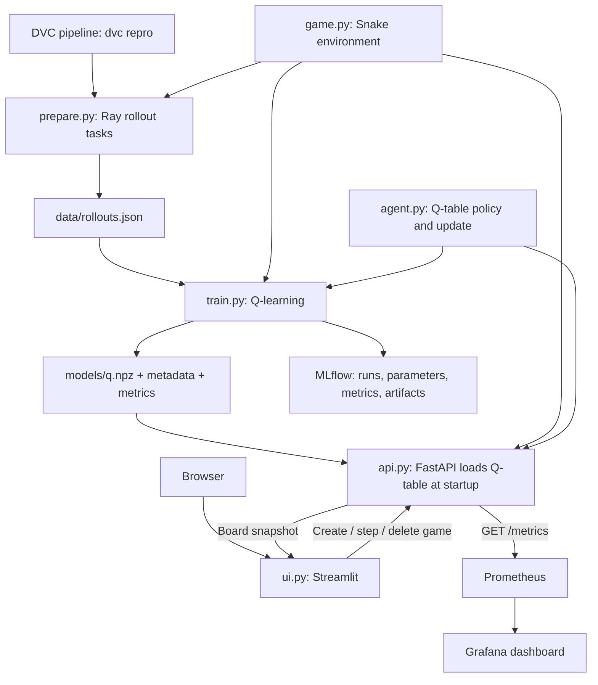

# Serpent Mind — Code documentation

This guide explains the implementation and how its parts work together.
For Ubuntu installation, the verified commands, VirtualBox forwarding and Windows
browser access, follow the [README](README.md).

## Contents

1. [Architecture](#1-architecture)
2. [Repository map](#2-repository-map)
3. [Snake environment](#3-snake-environment)
4. [Q-learning agent](#4-q-learning-agent)
5. [Ray preparation and training](#5-ray-preparation-and-training)
6. [Data, model and experiment versioning](#6-data-model-and-experiment-versioning)
7. [FastAPI reference](#7-fastapi-reference)
8. [Streamlit playback](#8-streamlit-playback)
9. [Monitoring](#9-monitoring)
10. [Containers and configuration](#10-containers-and-configuration)
11. [Tests and maintenance](#11-tests-and-maintenance)

## 1. Architecture

Training and serving use the same headless Python Snake environment.
The browser renders images; the game does not require Pygame or a desktop.
The learning algorithm is tabular Q-learning, not a neural network.



DVC records dependencies and output hashes; MLflow records each actual training
execution. Prometheus collects serving metrics. Ray is used for rollout generation
and shuts down afterward; online Q-learning runs sequentially in the trainer.
Spark is not used.

## 2. Repository map

| File | Responsibility |
|---|---|
| [snake/game.py](snake/game.py) | Board, food, collision detection, rewards, observations and snapshots. |
| [snake/agent.py](snake/agent.py) | Q-table creation, epsilon-greedy action selection, learning and model loading. |
| [snake/prepare.py](snake/prepare.py) | Two-CPU Ray runtime and 100 seeded random-policy rollouts. |
| [snake/train.py](snake/train.py) | Warm start, online training, evaluation, MLflow logging and artifact writes. |
| [snake/api.py](snake/api.py) | Model startup, game sessions, HTTP routes and Prometheus instrumentation. |
| [ui.py](ui.py) | Streamlit controls, API requests and board rendering. |
| [dvc.yaml](dvc.yaml) | Prepare/train stage commands, dependencies, outputs and metrics. |
| [dvc.lock](dvc.lock) | DVC-generated stage and artifact hashes; update through DVC. |
| [requirements.txt](requirements.txt) | Direct dependency pins, including SQLAlchemy and pathspec compatibility pins. |
| [Dockerfile](Dockerfile) | Shared Python 3.11 image, resumable pip downloads, Git and repository trust configuration. |
| [compose.yaml](compose.yaml) | Service commands, volumes, ports, memory limits and dependencies. |
| [compose.cloud.yaml](compose.cloud.yaml) | Optional managed-cloud proxy CA build-secret override; not needed for normal Ubuntu setup. |
| [monitoring/prometheus.yml](monitoring/prometheus.yml) | Scrapes the API every five seconds. |
| [monitoring/grafana/provisioning/datasources/prometheus.yml](monitoring/grafana/provisioning/datasources/prometheus.yml) | Creates the Prometheus data source. |
| [monitoring/grafana/provisioning/dashboards/snake.yml](monitoring/grafana/provisioning/dashboards/snake.yml) | Loads the dashboard from its provisioned directory. |
| [monitoring/grafana/dashboards/snake.json](monitoring/grafana/dashboards/snake.json) | Six dashboard panels and their PromQL queries. |
| [tests/test_core.py](tests/test_core.py) | Four tests for rules, learning/model loading and an API game. |
| [VALIDATION.md](VALIDATION.md) | Original managed-environment validation report and its limits. The README also records the later user-VM demonstration. |

## 3. Snake environment

### Coordinates and state held by the game

`Snake(seed=0, size=10)` creates a seeded game. Production training and serving
use the default 10 × 10 board. The configurable size is not validated for arbitrary
small values; use the default unless changing and checking the implementation.

Coordinates are `(x, y)`: x increases to the right and y increases downward.
`body[0]` is the head. The initial body has three cells, centered horizontally,
and initially points right.

| Attribute | Meaning |
|---|---|
| `rng` | A private `random.Random(seed)` generator. |
| `size` | Board width and height. |
| `body` | Ordered list of occupied coordinates, head first. |
| `direction` | 0 right, 1 down, 2 left, 3 up. |
| `food` | An unoccupied coordinate, or `None` when the board is full. |
| `score` | Number of food items eaten; distinct from accumulated reward. |
| `steps` | Number of attempted moves, including a final collision attempt. |
| `hungry` | Moves since the last food item. |
| `done` | Whether the game has ended. |

### Actions and rewards

Actions are relative to the current direction:

| Action | Meaning | Direction offset modulo 4 |
|---|---|---|
| 0 | Continue straight | 0 |
| 1 | Turn right and move | +1 |
| 2 | Turn left and move | -1 |

There is no direct reverse action. `step(action)` updates the game and returns
a numeric reward, rather than a Gym-style tuple:

| Result | Reward |
|---|---|
| Eat food | +10.0 |
| Hit a wall or occupied body cell | -10.0 |
| Other legal move | -0.01 |

A legal move inserts a new head. Eating preserves the tail, increases score and
resets hunger; otherwise the tail is removed. Moving into the old tail cell is
legal if that tail will vacate. `danger(direction)` handles this distinction.

The game ends on collision, a full board, 100 moves without food, or 3,000 total
moves. A timeout does not add a separate death penalty: the current move's reward
is returned. Calling `step` after completion or with an action outside 0/1/2
raises `ValueError`.

### Observation encoding

`state()` compresses 11 booleans into an integer Q-table row:

```text
state_id = sum(int(bit[i]) * 2**i for i in range(11))
```

| Bit | True when |
|---|---|
| 0 | Moving straight would collide. |
| 1 | Turning right would collide. |
| 2 | Turning left would collide. |
| 3 | Current direction is right. |
| 4 | Current direction is down. |
| 5 | Current direction is left. |
| 6 | Current direction is up. |
| 7 | Food is left of the head. |
| 8 | Food is right of the head. |
| 9 | Food is above the head. |
| 10 | Food is below the head. |

The integer is in 0–2047. Some bit combinations are unreachable because direction
is one-hot. For example, with no immediate danger, direction right, and food to
the right and above, the state ID is `8 + 256 + 512 = 776`.

The observation omits the full body layout and distances. Different board layouts
can share an observation, so the agent can get trapped; filling the board is not
guaranteed.

### Method reference

| Method | Behavior |
|---|---|
| `_food()` | Enumerates empty cells and randomly chooses one; returns None if none remain. |
| `danger(direction)` | Checks the next absolute direction for a wall/body collision. |
| `state()` | Builds the 11-bit integer observation. |
| `step(action)` | Applies one relative action and returns its reward. |
| `snapshot()` | Returns size, body, food, score, steps and done for UI/API use. |

## 4. Q-learning agent

`Agent(seed=0)` allocates a zero-filled `float32` array with shape `(2048, 3)`.
Rows are observations and columns are actions. The raw table occupies 24,576
bytes (24 KiB), so no GPU or deep-learning framework is needed.

### Action selection

`act(state, epsilon=0)` chooses a random action with probability epsilon.
Otherwise it uses `numpy.argmax(q[state])`. Ties choose the first action,
so a zero table chooses straight when epsilon is zero.

Serving and evaluation use epsilon zero: they exploit the stored table and do
not learn from the live games.

### Learning update

`learn(state, action, reward, next_state, done)` uses learning rate alpha 0.1
and discount gamma 0.95:

```text
target = reward                         if done
target = reward + 0.95 * max(Q[next])     otherwise

Q[state, action] += 0.1 * (target - Q[state, action])
```

For example, a terminal food reward of 10 updates an initially zero entry to 1.
Terminal transitions never bootstrap from the next row.

### Loading

`Agent.load(path)` reads an NPZ file containing the array under key `q`,
with `allow_pickle=False`. It checks shape `(2048, 3)` and finite values.
Missing, malformed or incompatible model files prevent API startup; there is
no automatic untrained fallback. Loading is not a general artifact authenticity
check.

## 5. Ray preparation and training

### Preparation: snake/prepare.py

`main()` starts Ray with two CPU resources, dashboard disabled and a 100 MiB
object store. It submits `rollout(seed)` tasks for seeds 0–99, waits for the
results, writes JSON, then shuts Ray down in a `finally` block.

Each task creates a game and takes uniformly random actions until completion.
The record format is:

```text
{
  "seed": integer,
  "score": integer,
  "steps": integer,
  "transitions": [
    [state_id, action, reward, next_state_id, done],
    ...
  ]
}
```

The file contains a JSON array of 100 such episode records.
Random actions and food placement both use that game's seeded random generator.
Ray parallelizes these independent episode tasks; it does not run a persistent
cluster or distribute the Q-learning updates.

### Training: snake/train.py

`main()` accepts `--episodes` (default 30000, must be positive) and `--seed`
(default 42). The sequence is:

1. Read `data/rollouts.json` and compute the SHA-256 of its raw bytes.
2. Select the MLflow experiment `snake-q-learning` and open a run.
3. Construct a fresh Agent and learn once from every saved transition.
4. Generate fresh online episodes, learning after each move.
5. Log the latest 100-game mean score and epsilon every 100 episodes.
6. Evaluate the learned table and a fresh zero-table agent on held-out seeds.
7. Save the model, metrics and metadata, and upload the model directory to MLflow.

Episode `e` uses game seed `seed + e`. Exploration follows:

```text
epsilon = max(0.02, 1 - e / (episodes * 0.8))
```

A run starts from a new table, not the previous model. The saved rollout
transitions provide a warm start, followed by online learning.

### Evaluation

`evaluate(agent, episodes=100)` plays greedy games with seeds 100000–100099
by default, and returns mean food eaten per game. These seeds are outside the
default online training seed range.

`untrained_mean_score` uses a new zero table, whose greedy tie-break chooses
straight. It is not a random-policy baseline. There is no confidence interval,
multiple-training-seed study or automatic quality threshold in this implementation.

The demonstrated run reported 16.58 for the trained agent and 0.06 for the
untrained greedy baseline. Those observations do not guarantee a score on every
game or every future training run.

## 6. Data, model and experiment versioning

### DVC stage graph

`dvc.yaml` defines `prepare → train`.

| Stage | Dependencies | Outputs |
|---|---|---|
| prepare | requirements.txt, prepare.py, game.py | data/rollouts.json |
| train | requirements.txt, rollouts.json, game.py, agent.py, train.py | models/q.npz, models/metadata.json, models/metrics.json |

The metrics JSON has `cache: false`; it remains an output metric tracked in Git,
while the rollout/model outputs are stored in the local DVC cache.
DVC writes hashes into `dvc.lock`. Do not manually invent or edit those hashes.

A normal `dvc repro` skips unchanged stages when outputs are available.
`dvc repro --force` reruns stages. A skipped training stage creates no new MLflow
run. The repository includes DVC configuration already; do not initialize it again.

### Generated files

| File | Contents and persistence |
|---|---|
| data/rollouts.json | 100 random-policy episodes and transitions; DVC-cached. |
| models/q.npz | Compressed Q-table with key q; DVC-cached. |
| models/metadata.json | MLflow run ID, episode count, seed and dataset SHA-256; DVC-cached. |
| models/metrics.json | eval_mean_score and untrained_mean_score; tracked in Git. |
| .dvc/cache/ | Local historical DVC artifact cache. |
| dvc.lock | Stage dependency/output hashes, tracked in Git. |

The trainer writes `models/q.tmp` then uses `os.replace` to replace `q.npz`
atomically. Metrics and metadata are written separately; the whole directory is
not updated as one transaction. The API loads only `q.npz`.

Git alone does not contain the cached raw dataset or weights. No DVC remote is
configured by default, and the local cache is not an off-machine backup.
Use a configured remote and push/pull if historical artifacts must be shared.

### MLflow records

| Record | Names |
|---|---|
| Parameters | episodes, seed, alpha, gamma, grid_size, data_sha256 |
| Per-100-episode metrics | train_score_mean_100, epsilon |
| Final metrics | eval_mean_score, untrained_mean_score |
| Artifacts | Files from models/ uploaded under model/ |

The tracking URI is configurable through `MLFLOW_TRACKING_URI`. In Compose it is
`http://mlflow:5000`; outside Compose the training default is
`http://localhost:5000`. The named tracking volume holds the SQLite database and
proxied artifact files. The browser uses localhost through the README's tunnel.

There is no model registry promotion step or automatic rollback. Serving uses
the locally produced model; restart the API after replacing it. Saving a local
model and successfully uploading MLflow artifacts are separate operations.

## 7. FastAPI reference

### Startup and sessions

The lifespan hook loads one Agent into `app.state.agent`. Session entries are
`UUID → (Snake, last_activity_monotonic_time)`, held in process memory.
A lock serializes session access and each decision.

At most 100 active sessions are retained. An inactive session expires after
600 seconds. Cleanup is triggered by create, step and metrics requests, not a
background timer. Finished games are immediately removed. Sessions disappear
on process restart. Run the configured single API worker; multiple independent
workers would not share these sessions.

### Routes

| Method and path | Request | Successful response |
|---|---|---|
| GET /health | None | 200: status ok. |
| POST /games | JSON object with optional seed field, default 42 | 200: id plus initial snapshot. |
| POST /games/{key}/step | No body | 200: snapshot after one agent-selected move. |
| DELETE /games/{key} | No body | 200: status closed, even when the key is already absent. |
| GET /metrics | None | Prometheus text exposition. |
| GET /docs | None | FastAPI's interactive generated API documentation. |

The game-creation JSON body is required; `{}` uses the default seed.
Seed must be an integer from 0 through 2147483647. Invalid input produces a
FastAPI validation response (422). A full session pool produces 429.
An unknown, expired or already-finished session produces 404 on a step request.

A final step still returns 200 with `done: true`, then removes the session.
Further steps with that ID return 404. Callers cannot choose actions through
the API: the loaded agent chooses each move.

### Snapshot schema

```json
{
  "size": 10,
  "body": [[5, 5], [4, 5], [3, 5]],
  "food": [8, 3],
  "score": 0,
  "steps": 0,
  "done": false
}
```

This is an illustrative response shape, not a guaranteed food coordinate.
Coordinates become JSON arrays; `food` becomes null on a full board.
Creation additionally includes an `id`; step responses do not.

### Example requests

Run these in the Ubuntu VM with the API already running. Install curl if needed:

```bash
sudo apt-get install -y curl
curl -fsS http://localhost:8000/health
curl -fsS -X POST http://localhost:8000/games -H 'Content-Type: application/json' -d '{"seed":42}'
```

Copy the returned id into GAME_ID, then use the same terminal:

```bash
GAME_ID='paste-returned-id-here'
curl -fsS -X POST "http://localhost:8000/games/$GAME_ID/step"
curl -fsS -X DELETE "http://localhost:8000/games/$GAME_ID"
curl -fsS http://localhost:8000/metrics
```

These URLs also work from Windows only if the API port 8000 is included in the
SSH tunnel. See the README's optional all-services tunnel.

## 8. Streamlit playback

`ui.py` reads `API_URL`, defaulting to `http://localhost:8000`.
Compose sets it to `http://api:8000`.

Clicking Play sends a create request with the selected seed. The UI renders the
initial snapshot, then repeatedly sleeps for `1 / speed`, requests a step,
and renders the new snapshot until done. The slider selects 1–30 requested moves
per second; network, rendering and processing overhead add to that interval.

`render(game)` creates a NumPy RGB grid: dark background, green body,
light-green head and red food. Each cell is expanded 32 times per axis and the
image is displayed at width 400. The score and attempted-move count are shown
under the board.

Requests use ten-second timeouts. Errors are shown in Streamlit. A `finally`
block attempts to delete the session with a five-second timeout; it tolerates
deletion failure. Games finish before the next Play click in the normal flow.
The frontend never modifies the Q-table.

## 9. Monitoring

Prometheus scrapes `api:8000/metrics` every five seconds.
The API's prometheus_client registry also exports its default Python/process
metrics where supported.

| Custom metric | Type | Meaning |
|---|---|---|
| snake_games_total | Counter | Successfully created games. |
| snake_steps_total | Counter | Agent-selected game steps performed by the API. |
| snake_active_games | Gauge | Retained active sessions after updates/cleanup. |
| snake_score | Histogram | Scores of games that reach done through a step request. |
| snake_inference_seconds | Histogram | Time spent in Agent.act, not full HTTP latency or game.step. |

Histograms expose `_bucket`, `_sum` and `_count` series.
Score buckets are 0, 1, 2, 5, 10, 20, 50 and 100, plus infinity.
Deleted or expired unfinished games do not contribute a completed score.

The provisioned Grafana dashboard uses these queries:

| Panel | PromQL |
|---|---|
| Games started | `snake_games_total` |
| Active games | `snake_active_games` |
| Moves per second | `rate(snake_steps_total[1m])` |
| Mean completed score | `snake_score_sum / clamp_min(snake_score_count, 1)` |
| Decision latency p95 | `histogram_quantile(0.95, sum(rate(snake_inference_seconds_bucket[5m])) by (le))` |
| API up | `up{job="snake"}` |

Counters reset on API restart. Rates need several scrapes; score statistics need
completed games. Histogram quantiles are bucket-based estimates, especially
coarse for this very small model's fast decisions. API up indicates scrape
success, not an end-to-end test of the game. Prometheus retention is limited to
two days and 256 MB. No alert rules are configured.

## 10. Containers and configuration

### Services

| Service | Role | VM loopback port | Memory limit |
|---|---|---|---|
| mlflow | One-worker tracking server with SQLite and artifacts | 5000 | 600 MB |
| trainer | One-off DVC pipeline; two CPU quota, 256 MB shared memory | None | 1800 MB |
| api | One Uvicorn worker serving the loaded model | 8000 | 300 MB |
| ui | Streamlit frontend | 8501 | 400 MB |
| prometheus | Metrics scraper and local time-series storage | 9090 | 250 MB |
| grafana | Provisioned monitoring dashboard | 3000 | 300 MB |

Compose memory strings use `m`; these are configured caps, not measurements of
actual memory use. The OS, Docker and build process need memory too.
Training runs with only MLflow; the application and monitoring start afterward
on the 4 GB target VM. The trainer uses the training profile and is invoked
explicitly with `docker compose run`.

The Python services share `snake-aiops:local`. The image includes all Python
dependencies and Git. It has a default root user, so mounted training outputs
may become root-owned; the README gives the ownership correction command.
Do not use an arbitrary numeric user without a corresponding container account.

### Storage and dependency order

- The trainer mounts the project at /app, so data/model/DVC files persist on the VM.
- The API mounts models/ read-only and reads its table once at startup.
- MLflow uses tracking, Prometheus uses prometheus, and Grafana uses grafana named volumes.
- The trainer waits for MLflow health; the UI waits for API health.
- The API has no Compose dependency on the trainer: finish training before starting it.
- MLflow and the API have explicit HTTP healthchecks in compose.yaml.
  Successful startup of other services does not by itself validate their complete user flows.

Normal `docker compose down` preserves named volumes. Using `down -v` deletes
them. Keep those volumes and the project/DVC cache when retaining run history.

### Runtime configuration

| Setting | Consumer | Default or Compose value |
|---|---|---|
| MLFLOW_TRACKING_URI | Training | localhost:5000 by default; http://mlflow:5000 in Compose. |
| MODEL_PATH | API | models/q.npz |
| API_URL | Streamlit | localhost:8000 by default; http://api:8000 in Compose. |
| NO_PROXY / no_proxy | Trainer and UI | localhost, 127.0.0.1, mlflow, api in Compose. |

The localhost defaults include the http:// scheme in code.
Training length and seed are CLI arguments in dvc.yaml, not environment variables.
Learning rate, discount, rewards, board size and observation structure are code
constants rather than a separate parameter configuration file.

Published ports bind to 127.0.0.1 on the VM. For a Windows browser and a terminal-only
Ubuntu VM, use the README's VirtualBox NAT SSH rule and SSH tunnel. No Ubuntu GUI
is required. Keep the VM and SSH session running during browser use.

This is a local educational deployment: it does not implement authentication,
persistent/multiworker game sessions, automated promotion, or automated retraining.

## 11. Tests and maintenance

### Existing tests

Run inside the Ubuntu project directory:

```bash
sudo docker compose run --rm --no-deps trainer python -m pytest -q
```

| Test | What it checks |
|---|---|
| test_food_and_collision | Food reward/growth and a subsequent wall collision. |
| test_tail_cell_is_legal | Entering a tail cell that vacates is legal. |
| test_update_and_roundtrip | A terminal Q-update, NPZ saving/loading and greedy selection. |
| test_api | Model startup, creation, a complete game, post-completion 404 and metrics output. |

The API test uses a temporary zero-table model and does not require an existing
trained model, MLflow or Ray. These tests do not benchmark training quality or
validate a complete Docker deployment, SSH tunnel, Prometheus scrape or Grafana UI.

### Choosing where to change behavior

| Desired change | Relevant code/config | Follow-up |
|---|---|---|
| Game rules or rewards | game.py | Reproduce affected DVC stages, retrain and rebuild/restart serving code. |
| Observation bits or action schema | game.py, agent.py | Update table/API assumptions and tests, then retrain; old models can be incompatible. |
| Alpha or gamma | agent.py, logged parameters in train.py | Keep logged values consistent, retrain and rebuild serving code if changed. |
| Training episodes or seed | train command in dvc.yaml | Run DVC; restart API to load the resulting model. |
| Number of rollout episodes/workers | prepare.py | Reproduce preparation and training. |
| UI appearance or controls | ui.py | Rebuild the shared image and recreate UI. |
| API behavior or metrics | api.py | Rebuild/recreate API; update relevant tests/dashboard as needed. |
| Prometheus/Grafana configuration | monitoring/ | Restart/recreate the affected service to reload mounted configuration. |

For existing deployments on a small VM, stop the game/monitoring services before
training. After code changes, rebuild the shared image and use Compose up to
recreate the relevant services. A simple restart does not rebuild code baked into
an image; changing only the model file requires an API restart instead.
The verified operational commands and ownership correction are in the README.

Keep this guide aligned with the actual sources when changing schemas,
hyperparameters, artifacts or routes.
